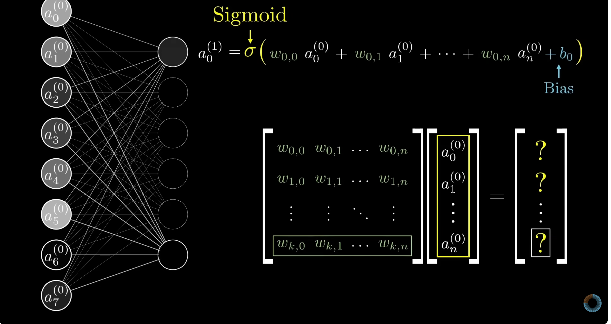

首先，需要摆明一个核心认知：“世界上的所有事情都可以被视为一个函数，我们能做的就只有拟合”。

视频中举的是一个经典例子：使用神经网络识别数字。

什么是神经网络？本质上它是一个函数，只不过这个函数通常包含大量的参数，训练就是确定参数值的过程。

输入层是一个 28 x 28 像素的图片，包含两层隐藏层，最后一个输出层，将输入的图片排列为一层，然后第一层隐藏层中 16 个神经元中的每一个神经元和输入层的每个神经元连接。

第二层隐藏层也是 16 个神经元，其中每个也和上一层的每个神经元连接，输出层也是同理。

神经网络中的每一层都是一层抽象，第一层隐藏层用于识别短边、角点等，第二层隐藏层用于识别数字的部件，输出可能的每个数字的概率。

如果不对神经网络中的神经元加以限制，可能会得到任意值，所以会使用一些函数将神经元的值限制在 0-1 之间，常用的有 Sigmod, ReLU 等。

为了方便表示，很容易想到线性代数，因为这里的神经网络本质上是 权重 * 神经元值 ... + 偏置值，非常符合矩阵元算的表示方法。